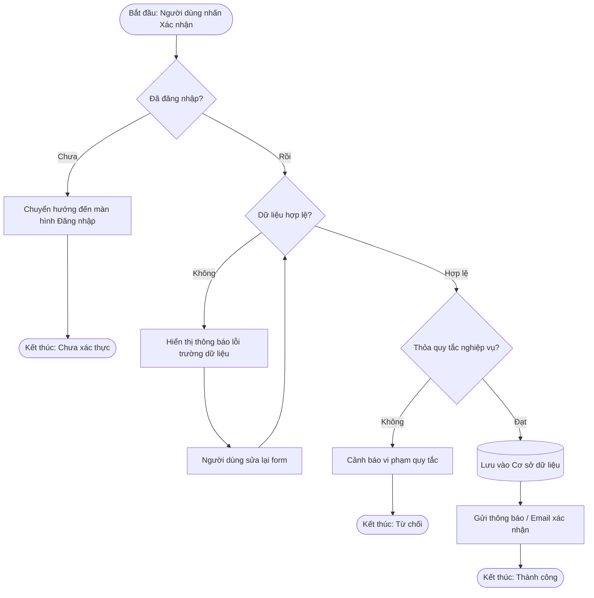
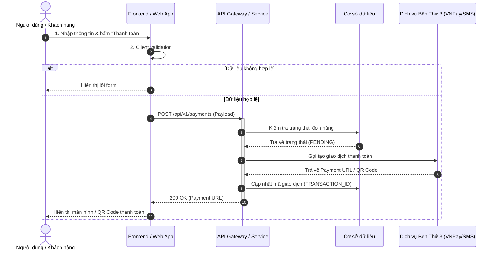
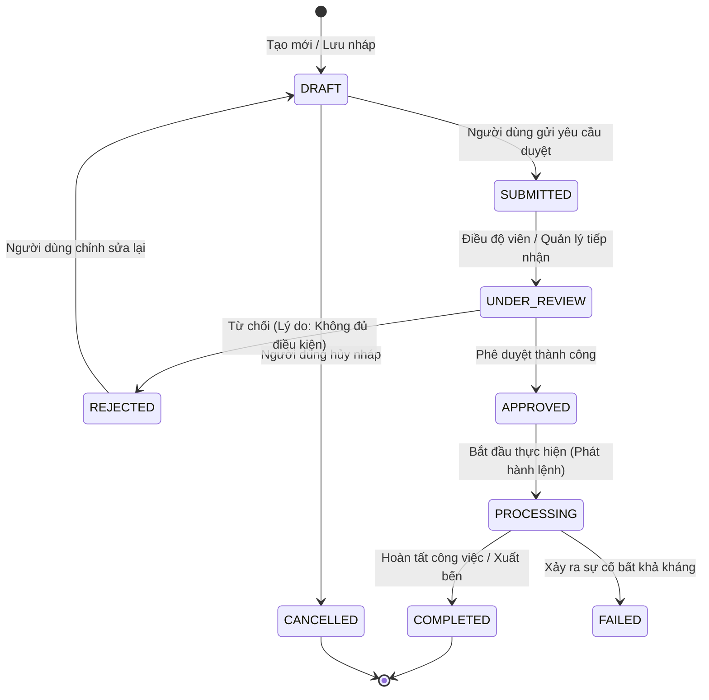
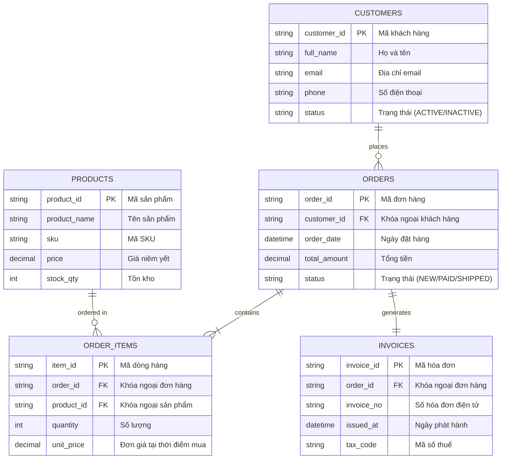

# Thiết Kế Sơ Đồ Nghiệp Vụ & Dữ Liệu Bằng Mermaid

Kỹ năng này giúp BA tự động chuyển hóa mô tả logic bằng lời, tài liệu quy trình, hoặc yêu cầu kỹ thuật thành các sơ đồ **Mermaid** chuẩn xác, thẩm mỹ cao và render được ngay lập tức trên Markdown, Notion, Confluence, GitHub hoặc IDE.

---

## 1. Các Loại Sơ Đồ Trọng Tâm & Cú Pháp Mẫu

### 1.1 Sơ Đồ Luồng Nghiệp Vụ (Flowchart / Activity Diagram)
**Mục đích:** Mô tả các bước thao tác của người dùng, các điểm rẽ nhánh logic (Decision points), và kết thúc luồng.

---

### 1.2 Sơ Đồ Tuần Tự (Sequence Diagram)
**Mục đích:** Thể hiện thứ tự gửi thông điệp (gọi API, truy vấn DB, gọi service ngoài) giữa Actor, Frontend, Backend Services và Database.

---

### 1.3 Sơ Đồ Máy Trạng Thái (State Diagram)
**Mục đích:** Thể hiện toàn bộ vòng đời (Lifecycle) của một thực thể (Đơn hàng, Container, Booking, Hóa đơn...), các điều kiện kích hoạt chuyển trạng thái và trạng thái cuối cùng.

---

### 1.4 Sơ Đồ Quan Hệ Thực Thể (Entity Relationship Diagram - ERD)
**Mục đích:** Mô tả các bảng dữ liệu, khóa chính (PK), khóa ngoại (FK), các trường dữ liệu và quan hệ giữa các thực thể (1-1, 1-N, N-N).

---

## 2. Quy Tắc Tránh Lỗi Khi Viết Mermaid Cho BA

1. **Bọc nhãn chứa ký tự đặc biệt:** Nếu tên node hoặc mô tả chứa dấu ngoặc đơn `()`, dấu phẩy `,`, dấu hai chấm `:`, luôn bọc nội dung trong ngoặc kép: `id["Nhãn có (thông tin thêm)"]`.
2. **Tránh thẻ HTML phức tạp:** Không sử dụng các thẻ HTML lồng nhau trong nhãn node để tránh lỗi parser trên các viewer markdown khác nhau.
3. **Màu sắc và phân nhóm trực quan:** Dùng `subgraph` trong flowchart để nhóm các phân hệ, hệ thống liên quan (ví dụ: `subgraph Frontend`, `subgraph Core Banking`).
4. **Luôn có chú thích nghiệp vụ:** Đặt tên tiếng Việt rõ ràng, dễ hiểu cho cả người làm nghiệp vụ lẫn lập trình viên.
