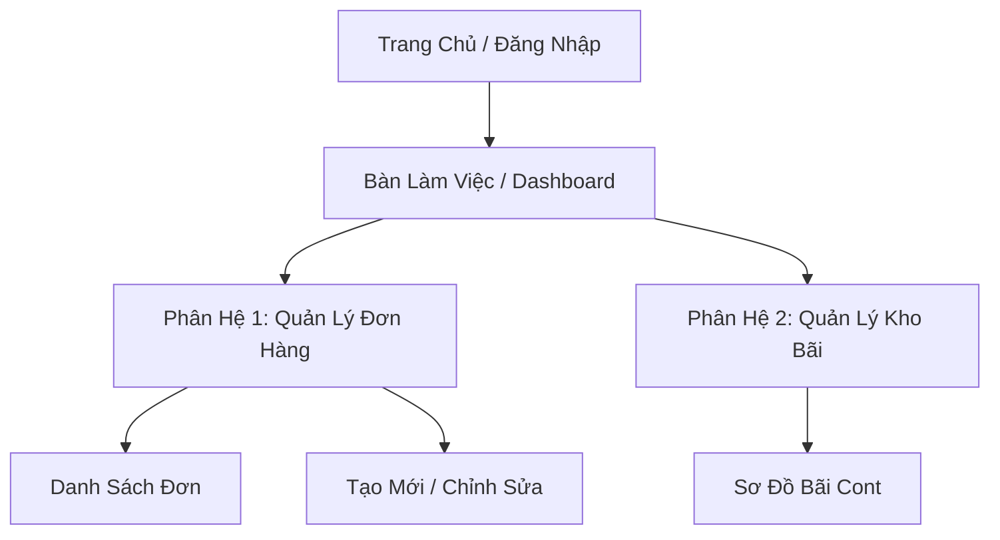

---
name: ba-reverse-engineering
description: "Khảo sát và dịch ngược một website, ứng dụng hoặc hệ thống legacy sẵn có thành bộ tài liệu phân tích nghiệp vụ hoàn chỉnh (Reverse Engineering). USE WHEN the user says 'dịch ngược hệ thống', 'khảo sát website thành spec', 'reverse engineering từ app cũ', 'tổng hợp yêu cầu từ hệ thống hiện có', '/reverse', or wants to extract BA requirements from an existing system or website."
---

# Dịch Ngược Hệ Thống & Website Thành Tài Liệu BA (Reverse Engineering)

Kỹ năng này giúp BA khảo sát một hệ thống phần mềm cũ (Legacy System), một website đang chạy thực tế, hoặc một ứng dụng đối thủ để **"dịch ngược" (Reverse Engineer)** toàn bộ kiến trúc nghiệp vụ, luồng thao tác và quy tắc ẩn thành bộ tài liệu đặc tả chuẩn mực, phục vụ cho việc đập đi xây lại (Re-platforming), di chuyển phân hệ (Migration), hoặc học hỏi tính năng.

---

## 🔍 Phương Pháp Khảo Sát & Dịch Ngược 5 Tầng

### Tầng 1: Kiến Trúc Thông Tin & Bản Đồ Trang (Sitemap & Navigation)
- Khảo sát toàn bộ cấu trúc thanh điều hướng (Menu, Sub-menu, Header, Sidebar).
- Xây dựng bản đồ màn hình (Sitemap / Screen Hierarchy).
- Xác định điểm bắt đầu (Landing / Dashboard) và các luồng đi sâu vào từng nghiệp vụ.

### Tầng 2: Bóc Tách Chân Dung Người Dùng & Phân Quyền (Roles & RBAC)
- Khảo sát các màn hình khác nhau khi đăng nhập dưới các vai trò khác nhau (Admin, Operator, Khách hàng).
- Liệt kê ma trận phân quyền ngầm định: Màn hình nào được xem, nút nào bị ẩn, thao tác nào yêu cầu phê duyệt.

### Tầng 3: Khôi Phục Quy Tắc Nghiệp Vụ Ẩn (Hidden Business Rules Discovery)
- **Ràng buộc trường dữ liệu (Field Validations):** Thử nhập sai, bỏ trống để bắt các câu thông báo lỗi (Error messages) -> Khôi phục điều kiện bắt buộc, định dạng regex, độ dài tối đa.
- **Trạng thái & Logic chuyển đổi (State Transitions):** Quan sát sự thay đổi màu sắc, nhãn trạng thái khi thực hiện hành động (ví dụ: Chờ duyệt -> Đã duyệt -> Đang giao).
- **Ràng buộc phụ thuộc giữa các trường:** Khi chọn Tỉnh/Thành phố thì danh sách Quận/Huyện tự lọc theo; khi chọn loại cont rỗng thì ẩn ô trọng lượng hàng.

### Tầng 4: Tái Cấu Trúc Mô Hình Dữ Liệu Ngầm Định (Inferred Data Model / ERD)
- Gom nhóm các trường thông tin trên từng form nhập liệu và bảng danh sách thành các Thực thể dữ liệu (Entities).
- Phân biệt Khóa chính (Mã duy nhất hiển thị), các trường liên kết khóa ngoại (Dropdown chọn đối tượng khác), và các trường lịch sử (Created at, Updated by).

### Tầng 5: Đóng Gói Thành Bộ Tài Liệu Chuẩn Bị Tái Thiết Kế
- Xuất ra Báo cáo Dịch Ngược Nghiệp Vụ (Reverse Engineering Report).
- Kích hoạt các skill tiếp theo (`ba-diagram`, `ba-srs`, `ba-user-story`) để tái sinh hệ thống mới.

---

## 📋 Mẫu Báo Cáo Dịch Ngược Hệ Thống (Reverse Engineering Spec)

```markdown
# [Tên Hệ Thống / Website] - Báo Cáo Dịch Ngược Nghiệp Vụ (Reverse Engineering)

- **Đối tượng khảo sát:** [URL website / Tên phần mềm legacy]
- **Thời gian thực hiện:** [YYYY-MM-DD]
- **Mục tiêu:** [Khảo sát để làm lại phân hệ mới / Phân tích đối thủ]

---

### 1. Bản Đồ Màn Hình & Cấu Trúc Điều Hướng (Sitemap)


---

### 2. Danh Mục Tính Năng Phát Hiện Được (Feature Catalog)
| Mã Tính Năng | Tên Tính Năng | Mô Tả Hành Động | Vai Trò Thực Hiện |
|---|---|---|---|
| FEAT-REV-01 | Tra cứu đơn hàng theo mã | Bộ lọc tìm kiếm nhanh với nhiều tiêu chí | Nhân viên & Khách |
| FEAT-REV-02 | Xuất báo cáo Excel | Tải file danh sách đã lọc ra tệp .xlsx | Quản lý ca |

---

### 3. Các Quy Tắc Nghiệp Vụ & Ràng Buộc Đã Bóc Tách (Extracted Business Rules)
- **BR-REV-01:** Trường [Mã số] bắt buộc phải có tiền tố cố định và 6 chữ số phía sau.
- **BR-REV-02:** Nút "Hủy đơn" chỉ hiển thị khi đơn đang ở trạng thái `CHỜ XỬ LÝ`. Khi đã `ĐANG GIAO` thì bị ẩn.
- **BR-REV-03:** Không cho phép chọn ngày giao hàng trong quá khứ.

---

### 4. Mô Hình Dữ Liệu Ngầm Định (Inferred Data Model)
| Thực Thể (Entity) | Các Trường Dữ Liệu Phát Hiện Được | Quan Hệ Dự Kiến |
|---|---|---|
| ORDERS | order_id, order_code, customer_name, total_fee, status, created_at | 1 - N với ORDER_ITEMS |
| CUSTOMERS | customer_id, full_name, phone, address, tax_code | 1 - N với ORDERS |

---

### 5. Khuyến Nghị Cải Tiến Khi Tái Thiết Kế (Modernization Recommendations)
- **Điểm yếu của hệ thống cũ:** Giao diện nhiều bước rườm rà, tải trang chậm khi dữ liệu lớn, thiếu validation realtime ngay khi gõ.
- **Đề xuất cho hệ thống mới:** Áp dụng thiết kế 1 trang (Single Page Form), bổ sung phím tắt và tìm kiếm thông minh tự động gợi ý.
```
