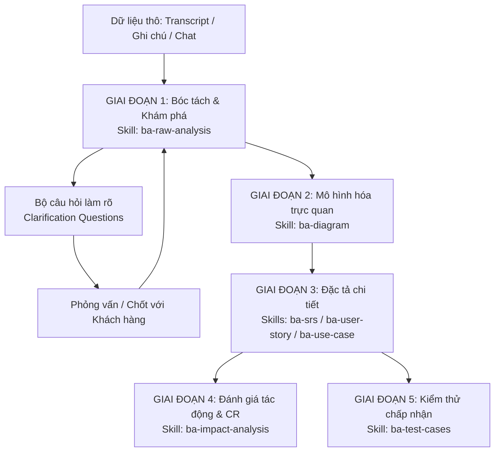

# 🧭 Quy Trình Phân Tích Nghiệp Vụ Toàn Diện Chuẩn AI4BA (End-to-End BA Workflow)

> **Hướng dẫn phương pháp luận và chuỗi hành động chuẩn đi từ Dữ liệu thô (Raw Transcript) đến Tài liệu đặc tả và Nghiệm thu UAT.**

---

## 🎯 Bản Chất Triết Lý AI4BA: "Human-in-the-Loop"
Trong quy trình làm việc với AI:
* **AI đóng vai trò:** Trợ lý ảo thực thi tác vụ nặng nhọc (Lọc dữ liệu, bóc tách cấu trúc, định dạng tài liệu, sinh mã sơ đồ, mở rộng kịch bản test).
* **BA đóng vai trò:** **Reviewer & Gatekeeper (Người thẩm định và gác cổng)** — Đặt câu hỏi chất vấn, kiểm tra tính logic, xác minh với khách hàng, và chịu trách nhiệm cao nhất về nghiệp vụ.

---

## 🔄 Chuỗi 5 Giai Đoạn Phân Tích Thực Chiến

---

### Giai Đoạn 1: Tiếp Nhận & Bóc Tách Dữ Liệu Thô (Ingestion & Discovery)
* **Đầu vào:** Transcript ghi âm cuộc họp (Otter/Teams/Zoom), ghi chú phỏng vấn, tin nhắn trao đổi rời rạc.
* **Kỹ năng sử dụng:** `/analyze-raw` hoặc `ba-raw-analysis`
* **Hành động của BA & AI:**
  1. AI lọc bỏ các đoạn "nhiễu" không liên quan đến nghiệp vụ.
  2. Bóc tách Stakeholders, Bảng thuật ngữ (Glossary).
  3. Phân loại rạch ròi: **Quyết định đã thống nhất (Agreed Decisions)** vs **Vấn đề còn bỏ ngỏ (Open Issues)**.
  4. Thực hiện **Gap Analysis**: Chỉ ra các trường hợp ngoại lệ, điểm mù mà cuộc họp chưa bàn đến.
  5. Sinh ra **Bộ câu hỏi làm rõ (Clarification Questions)**.
* **Cột mốc duyệt (Gate 1):** BA gửi bộ câu hỏi cho khách hàng hoặc họp ngắn để chốt các điểm Issue trước khi sang bước tiếp theo.

---

### Giai Đoạn 2: Mô Hình Hóa Nghiệp Vụ Trực Quan (Process & Data Modeling)
* **Đầu vào:** Các quyết định đã chốt từ Giai đoạn 1.
* **Kỹ năng sử dụng:** `/diagram` hoặc `ba-diagram`
* **Hành động:**
  1. Vẽ **Flowchart / Activity Diagram**: Thể hiện luồng người dùng thao tác và các điểm rẽ nhánh Yes/No.
  2. Vẽ **Sequence Diagram**: Thể hiện tương tác giữa Actor, UI, Backend API, Hệ thống bên thứ 3 và Database.
  3. Vẽ **State Machine Diagram**: Thể hiện toàn bộ vòng đời trạng thái của đối tượng nghiệp vụ (Ví dụ: Đơn hàng, Container, Booking).
  4. Vẽ **ERD**: Thể hiện các bảng dữ liệu và mối quan hệ 1-N, N-N.
* **Cột mốc duyệt (Gate 2):** Trình bày sơ đồ cho Dev và Khách hàng để thống nhất luồng đi của hệ thống.

---

### Giai Đoạn 3: Đặc Tả Chi Tiết Chuẩn Mực (Formal Specification)
* **Đầu vào:** Sơ đồ quy trình và các quyết định nghiệp vụ đã thống nhất.
* **Kỹ năng sử dụng (tùy mô hình dự án):**
  - **Mô hình Agile / Scrum:** Dùng `/story` hoặc `ba-user-story` để sinh User Stories chuẩn INVEST kèm bộ Acceptance Criteria chi tiết theo phong cách Given-When-Then.
  - **Mô hình Waterfall / Dự án lớn:** Dùng `/srs` hoặc `ba-srs` để xuất bản tài liệu SRS đầy đủ theo chuẩn IEEE 830 (FR, NFR, Data Dictionary, UI layout).
  - **Mô hình hệ thống tương tác phức tạp:** Dùng `/usecase` hoặc `ba-use-case` để viết Use Case Specification (Main Flow, Alt Flows, Exception Flows, Business Rules).
* **Cột mốc duyệt (Gate 3):** Product Owner phê duyệt tài liệu đặc tả, sẵn sàng đưa vào Sprint Backlog.

---

### Giai Đoạn 4: Quản Lý Thay Đổi & Đánh Giá Tác Động (CR & Impact Analysis)
* **Khi nào chạy:** Khi trong quá trình phát triển phát sinh yêu cầu thay đổi (Change Request - CR) từ khách hàng.
* **Kỹ năng sử dụng:** `/cr`, `/impact` hoặc `ba-impact-analysis`
* **Hành động:**
  - Phân tích Delta: As-Is (Hiện tại) vs To-Be (Sau thay đổi).
  - Đánh giá ma trận 6 chiều: Nghiệp vụ -> Màn hình UI -> API Backend -> Database Schema & Dữ liệu lịch sử -> Tích hợp chéo -> Báo cáo.
  - Xây dựng phương án Rollback và dự báo rủi ro.

---

### Giai Đoạn 5: Kiểm Thử Chấp Nhận & Nghiệm Thu (Verification & UAT)
* **Đầu vào:** Acceptance Criteria (AC), Use Case, Business Rules.
* **Kỹ năng sử dụng:** `/testcase` hoặc `ba-test-cases`
* **Hành động:**
  1. Xây dựng ma trận kịch bản kiểm thử (Test Scenarios) phân bổ theo mức ưu tiên từ P1 đến P4.
  2. Thiết kế chi tiết Test Cases chuẩn mực: Happy Path, Phân vùng tương đương, Phân tích giá trị biên (BVA), Phân quyền truy cập, Gửi liên tiếp (Concurrency).
* **Cột mốc duyệt (Gate 5):** Chạy kiểm thử nghiệm thu người dùng (UAT Sign-off) để nghiệm thu tính năng.

---

## 📌 Bảng Tóm Tắt Lệnh Tắt Trong Quy Trình

| Bước | Tác Vụ | Lệnh Tắt Gọi Agent | Kỹ Năng Kích Hoạt |
|---|---|---|---|
| **1** | Phân tích transcript, lọc nhiễu, gap analysis | `/analyze-raw` | `ba-raw-analysis` |
| **2** | Vẽ sơ đồ luồng, tuần tự, trạng thái, ERD | `/diagram` | `ba-diagram` |
| **3a** | Sinh User Story & AC (Given-When-Then) | `/story` hoặc `/ac` | `ba-user-story` |
| **3b** | Soạn tài liệu SRS hoàn chỉnh | `/srs` | `ba-srs` |
| **3c** | Đặc tả Use Case chi tiết (Cockburn) | `/usecase` | `ba-use-case` |
| **4** | Phân tích tác động khi có thay đổi (CR) | `/cr` hoặc `/impact` | `ba-impact-analysis` |
| **5** | Tạo ma trận Test Scenarios & Test Cases | `/testcase` | `ba-test-cases` |
