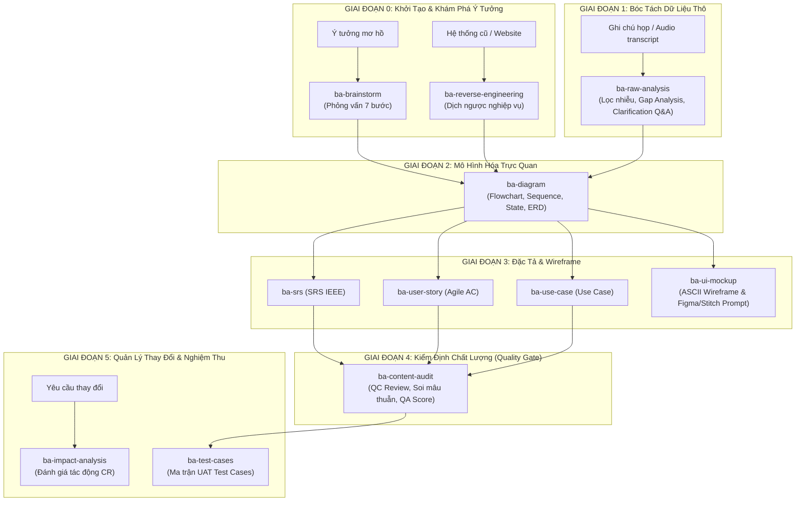

# 🧭 Quy Trình Phân Tích Nghiệp Vụ Toàn Diện 11 Kỹ Năng Chuẩn AI4BA (End-to-End BA Workflow)

> **Hệ sinh thái 11 kỹ năng chuyên sâu hỗ trợ trọn vẹn vòng đời một dự án phần mềm: Từ Ý tưởng mơ hồ -> Khảo sát hệ thống cũ -> Lọc dữ liệu thô -> Mô hình hóa -> Đặc tả -> Wireframe -> Thẩm định chất lượng -> Quản lý thay đổi -> Nghiệm thu UAT.**

---

## 🔄 Toàn Cảnh Chuỗi Quy Trình 6 Giai Đoạn (11 Skills Pipeline)

---

## 📋 Chi Tiết 11 Kỹ Năng & Lệnh Gọi Tắt

| STT | Kỹ Năng | Lệnh Tắt | Giai Đoạn | Mục Đích Chính |
|:---:|---|---|---|---|
| **1** | `ba-brainstorm` | `/brainstorm` | Khởi tạo | Phỏng vấn sâu 7 bước khi khách hàng chỉ có ý tưởng mơ hồ |
| **2** | `ba-reverse-engineering` | `/reverse` | Khảo sát | Dịch ngược một website, app cũ thành tài liệu BA & Business Rules |
| **3** | `ba-raw-analysis` | `/analyze-raw` | Khám phá | Lọc nhiễu transcript họp, bóc tách Quyết định vs Bỏ ngỏ, Clarification Q&A |
| **4** | `ba-diagram` | `/diagram` | Mô hình hóa | Sinh mã sơ đồ Mermaid (Flowchart, Sequence, State Machine, ERD) |
| **5** | `ba-srs` | `/srs` | Đặc tả | Soạn thảo tài liệu SRS hoàn chỉnh chuẩn IEEE 830 (FR, NFR, Data Dict) |
| **6** | `ba-user-story` | `/story`, `/ac` | Đặc tả Agile | Phân rã User Stories và viết Acceptance Criteria (Given-When-Then) |
| **7** | `ba-use-case` | `/usecase` | Đặc tả chi tiết | Bảng Use Case chuẩn Cockburn (Main Flow, Alt, Exception Flows) |
| **8** | `ba-ui-mockup` | `/mockup`, `/wireframe` | Thiết kế | Phác thảo ASCII Wireframe và sinh prompt cho Figma Make / Stitch / v0 |
| **9** | `ba-content-audit` | `/audit`, `/review` | Thẩm định | Soi mâu thuẫn chéo giữa các tài liệu, chấm điểm QA Readiness Score |
| **10** | `ba-impact-analysis` | `/cr`, `/impact` | Quản lý thay đổi | Ma trận đánh giá tác động 6 chiều khi có Change Request & Rollback Plan |
| **11** | `ba-test-cases` | `/testcase` | Nghiệm thu | Thiết kế ma trận kịch bản kiểm thử (P1-P4) và chi tiết UAT Test Cases |
