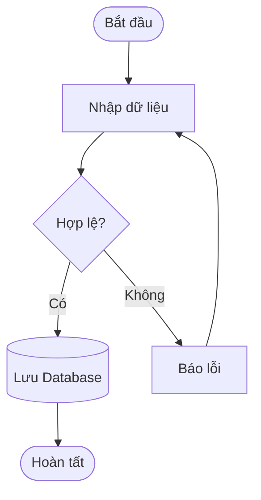
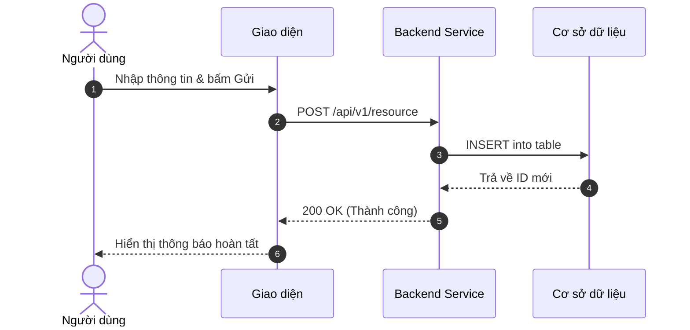
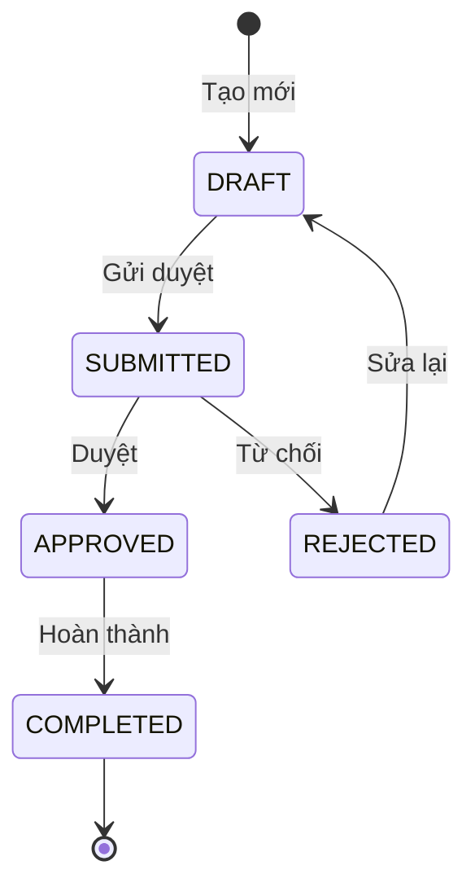
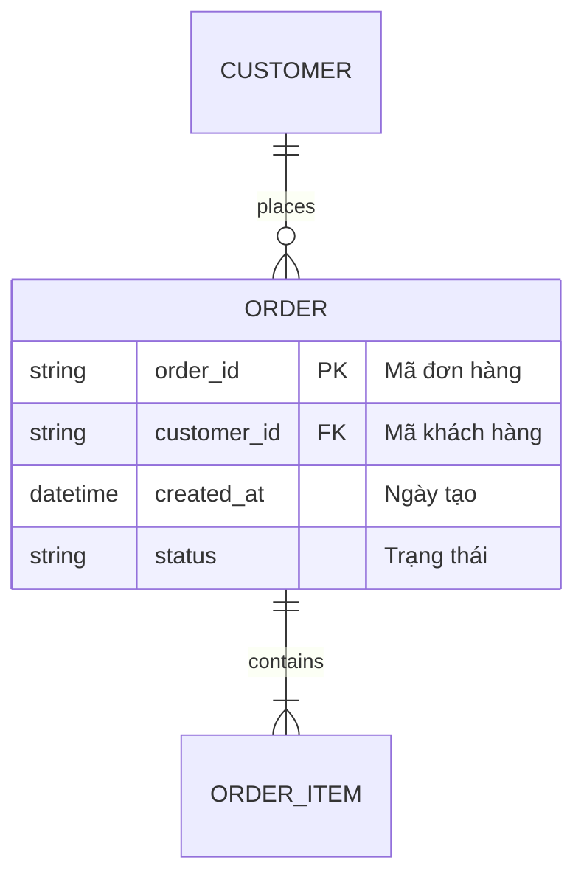

# Cẩm Nang Tra Cứu Nhanh Mermaid Cho BA (Mermaid Cheat Sheet)

Mermaid giúp BA phác thảo sơ đồ trực quan ngay trong tài liệu Markdown mà không cần mở Visio, Draw.io hay Miro.

---

## 1. Flowchart (Sơ Đồ Quy Trình Nghiệp Vụ)

## 2. Sequence Diagram (Sơ Đồ Tương Tác Giữa Các Hệ Thống)

## 3. State Diagram (Vòng Đời Trạng Thái)

## 4. Entity Relationship Diagram (ERD - Cấu Trúc Dữ Liệu)

